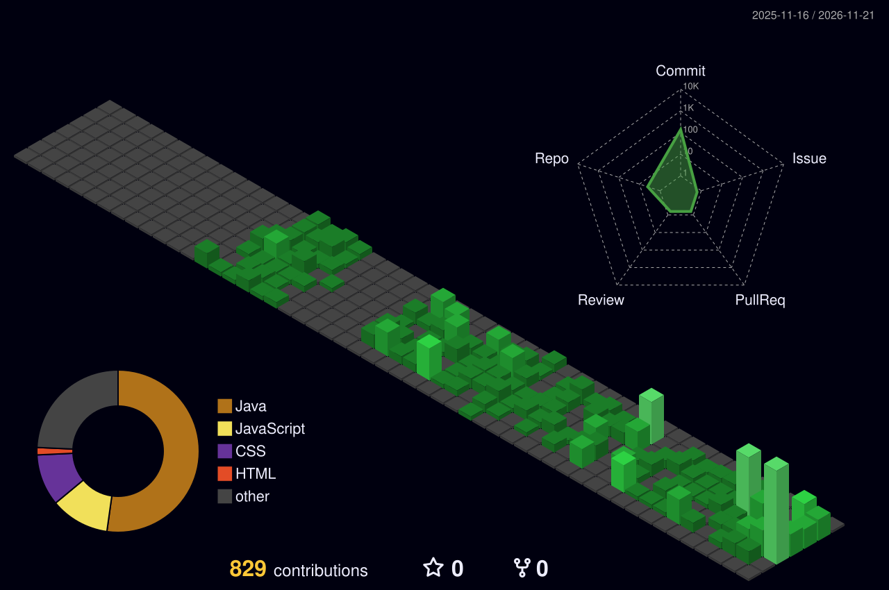

 

 

<table>
<tr>
<td width="55%" valign="top">

### 👋 Sobre mim

Sou desenvolvedor full stack de **Fortaleza** e curso **Análise e Desenvolvimento de Sistemas**. Gosto de construir interfaces que fogem do comum, APIs bem organizadas e automações que economizam horas de trabalho.

- 🔭 Hoje estou mergulhando em **C# / .NET / Blazor** e **Clean Architecture**
- 🌱 Estudando **microsserviços** e **IA** aplicada ao dia a dia
- 🗺️ Curto mapas interativos, apps mobile e interfaces retrô
- ⚡ Fun fact: meu [portfólio](https://beautiful-fudge-a3b934.netlify.app) parece um Macintosh clássico 🖥️

</td>
<td width="45%" align="center" valign="middle">

</td>
</tr>
</table>

 

## 🛠️ Tecnologias

 
 

  

## 🐍 Minhas contribuições

 

  <a href="Marcelo-C-Silva_us.md">🇺🇸 English version</a>

